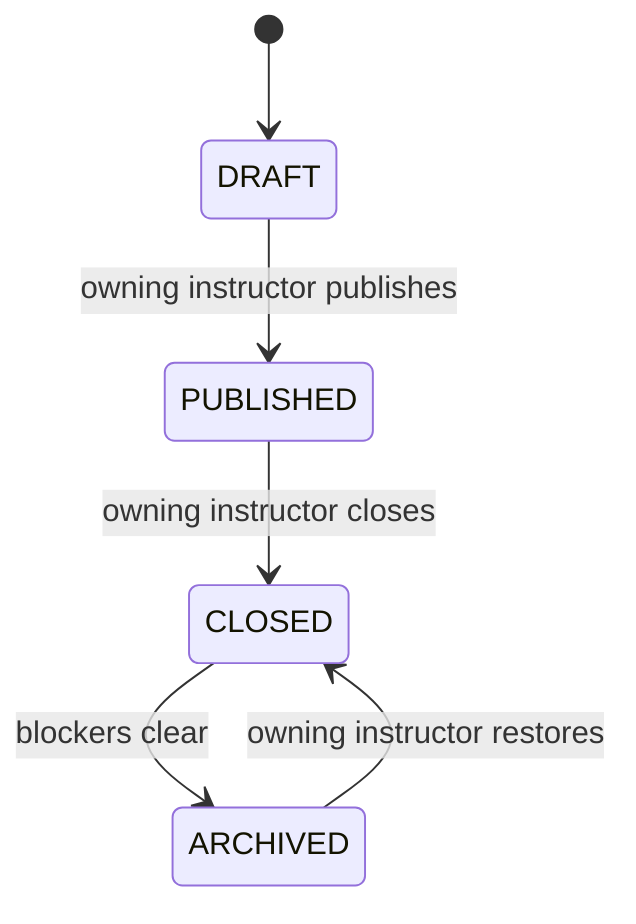
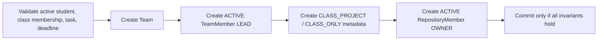
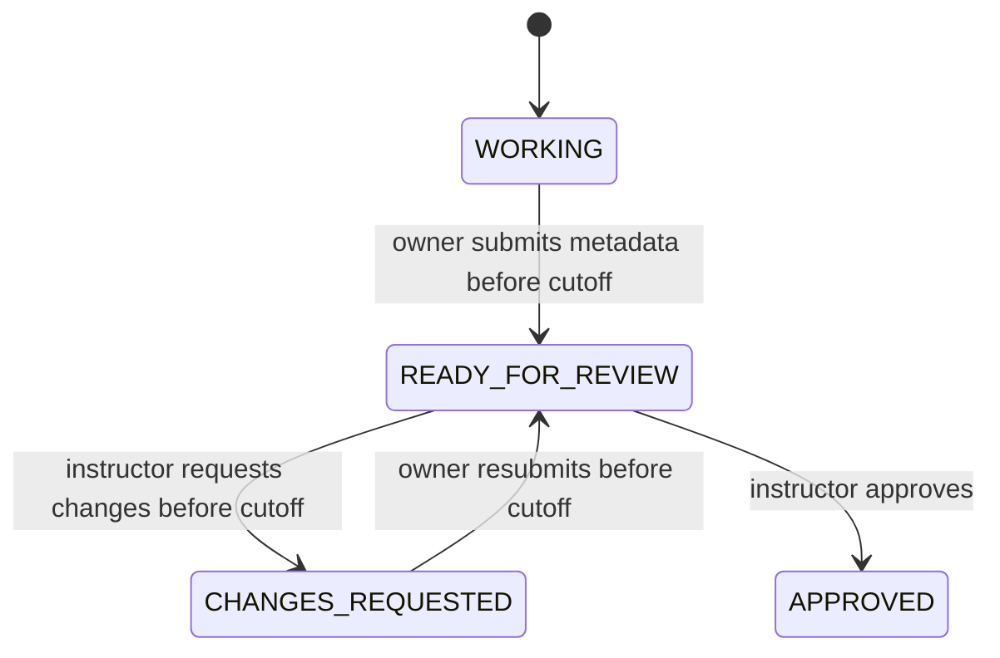

# Project and Repository Collaboration

## Approved Group Repository MVP extension (2026-10-18)

Product Owner clarification (2026-10-19): native Git clone/commit/push is
sufficient for Group MVP. Browser .java/.md editing is deferred; the retained
GROUP_REPOSITORY_BROWSER_EDITING_PROPOSAL.md is not an approved schema/job/write
contract. Source retention, job expiry and ambiguous commit recovery remain
unresolved future decisions. Current file navigation uses bounded filename search
separately from explicit exact-path fallback; unsupported Add File is hidden.
Demo database restoration/reconstruction is separately deferred; see
../DEMO_DATABASE_RECOVERY_ISSUE.md. Existing Git storage must remain untouched.

`docs/GROUP_REPOSITORY_MVP_DECISIONS.md` locks Student-led Team formation,
Maintainer (LEAD/OWNER), Developer (MEMBER), native local merge and read-only
Primary/active Co-Instructor Git oversight. Instructor assignment remains deferred.
These current details supersede historical exact-owner-only staff wording below.

`GET /repositories/:repositoryId/group-context` returns only academic identity,
current teaching-staff display names, active member count, current product role,
and effective source/member/review capabilities. Git capabilities reuse
`evaluateGitPermission`; action endpoints still authorize independently. Source
capabilities require READY storage; membership/review capabilities are distinct.
No storage locator, credential/verifier, email, join code or raw Git access record
is projected. Class-visible nonmembers receive metadata-only capabilities.

Student catalog `groupScope=MINE` selects active repository memberships within
current Class eligibility; `CLASS_METADATA` selects eligible same-Class metadata
without repository membership. Removed repository members are excluded from both
catalog and detail. Former Class members lose group metadata/activity authority,
including owner shortcuts; current teaching staff retain academic oversight.
Other repository types retain their existing policies.

Group UI is Code-first with academic header, five tabs and automatic-scope Code
menu. README is bounded escaped plain text, not executable HTML/Markdown. Recorded
accepted pushes are authenticated account signals, never verified authored commits
or grades. Existing review freeze and local Git/ref protections remain unchanged.

The approved compact UX work order retains that backend contract: one Group
route with Code, Commits, Branches, Members and Activity tabs; commit-pinned
folder/breadcrumb and bounded inline file inspection; escaped root README;
compact Members with an accessible Class-roster invitation dialog; header
ready/resubmit confirmation and existing Instructor review in a dialog.
Invitation eligibility and pending reservations remain server-authorized.
New Group Project forms default to eight members including the Maintainer, with
the existing 2–8 selector. Existing project limits and the database default of
four are unchanged; this presentation change requires no migration. Product
Owner visual acceptance of the implemented redesign remains pending.

The subsequent approved UX refinement keeps the same contracts: Project Detail's
Collaboration rail owns member/invited/unassigned/restricted entry states; Group
history groups by date, diffs retain escaped unified text with semantic color,
and branch/event lists remain truthful. Group event-driven revalidation uses a
15-second freshness window on tab/focus/visibility return, cancellation and
in-flight deduplication, with no background polling or credential issuance.
Dirty review/creation and open invitation/confirmation interactions defer
revalidation. Production backend authority and review-freeze policy are unchanged.
Design System v1 is documented under docs/design; broader adoption is not implied.

The final GitHub-familiar Group UI work order moves the sole Code menu and
existing exact-path file opener into the file toolbar. Selected-branch commit
totals come from history pagination.totalItems, not the all-head summary count;
inconsistent/moving-tip reads omit the number instead of guessing. Tab and branch
are URL-backed. Group commit details render only after selection, push activity
stays concise and truthful, and unfinished file-path input defers background
refresh. No general Group Add File API, schema, transport, review or authorization
change is implied. Product Owner visual acceptance remains pending.

The subsequent approved interaction refinement permits a truthful Add file
preview dialog without implementing browser file writes. The exact branch count
moves to the latest-commit row; real author/message/hash links open selected
commit details using URL state. Group copy feedback is transient and contains no
copied values. Group error views provide safe 404/5xx recovery and an exit;
authorization denials are never relabelled as work in progress. Credential
issuance, expiry, scope and secret lifetime remain governed by the same contract.

## Scope

This document is the authoritative Phase 7 backend contract for instructor-created project tasks, student-created repository metadata, teams, synchronized collaborators, invitations, textual project feedback, review lifecycle, monitoring, and archive protection.

Phase 7 does not modify the React frontend, provision repositories on disk, invoke Git, create commits or branches, calculate project grades, implement rubrics, transfer ownership, send invitation email, or populate `RepositoryActivity`. Those capabilities require later separately approved phases.

## Server-owned repository types

| Type | Required context | Visibility | Phase 7 behavior |
| --- | --- | --- | --- |
| `CLASS_PROJECT` | One project task and one team | `CLASS_ONLY` | Academic collaboration and instructor review metadata. |
| `PERSONAL` | No project task or team | `PRIVATE` | Owner-only metadata workspace. |

Clients cannot submit or mutate visibility, owner identity, project/class linkage, team identity, storage paths, default branch, review authority, or Git fields. `PUBLIC` is rejected. `storagePath` remains null until Phase 8 provisions server-owned storage.

## Project-task lifecycle



- Creation always produces `DRAFT`.
- Only the exact ACTIVE instructor who owns the class may create or mutate a task. Administrators receive safe read-only access.
- Draft metadata is editable with optimistic concurrency. Publication requires a future due date.
- Student access requires ACTIVE class membership and a `PUBLISHED` or `CLOSED` task.
- `CLOSED` rejects new student collaboration mutations but retains instructor review/monitoring access.
- `ARCHIVED` is read-only. Restore returns to `CLOSED`; it never silently republishes or reopens the task.

## Team and repository lifecycle

Creating a class-project repository is one serializable transaction:



- One team owns one class-project repository, and one class-project repository belongs to one team.
- A student may be ACTIVE on at most one team for a project task.
- The owner counts toward `maxTeamSize` and is both the ACTIVE team `LEAD` and ACTIVE repository `OWNER`.
- The lead/owner cannot leave or be removed. Ownership transfer is a known Phase 7 limitation and cannot be simulated by instructor intervention.
- Team and repository membership status remains synchronized as `ACTIVE` or `REMOVED`.
- Removal preserves both membership rows and timestamps. Reactivation reuses both rows; it does not create a second membership history row.
- Repository membership alone never creates academic team membership or class membership.

Repository review states are:



- `READY_FOR_REVIEW` means repository metadata was formally submitted for instructor review.
- `REQUEST_CHANGES` is allowed only while the task is `PUBLISHED`, before its deadline, and from `READY_FOR_REVIEW`.
- After the deadline or while `CLOSED`, the instructor may approve previously submitted `READY_FOR_REVIEW` work but cannot request changes.
- There is no Phase 7 late-revision window. A future post-deadline revision requires a separately approved server-controlled workflow.
- Students cannot resubmit, reopen review, edit metadata, change membership, or act on ordinary invitations after cutoff.
- Numeric project grades, rubrics, and final-grade calculation remain out of scope.

## Invitations

An ordinary invitation requires all of the following at the authoritative transaction:

- The caller is the ACTIVE team lead/repository owner.
- The class and repository are active and the task is `PUBLISHED` before its deadline.
- The invitee is an ACTIVE user with role `STUDENT` and ACTIVE membership in the same class.
- The invitee is not an ACTIVE member of any team for the same project task.
- The invitee is not already an ACTIVE member of this repository.
- No unexpired PENDING invitation already exists for the invitee/project task.
- ACTIVE team members plus unexpired PENDING invitations remain within `maxTeamSize`.

Expiry is `min(createdAt + 7 days, projectTask.dueDate)`. Reads may project an elapsed PENDING invitation as expired; mutation paths persist `EXPIRED` transactionally. No background scheduler is required.

Acceptance locks and validates the invitation, then creates or reactivates both `TeamMember` and `RepositoryMember` and marks the invitation `ACCEPTED` in one transaction. Decline and ordinary owner revoke are available only before cutoff. The owning instructor may revoke an otherwise blocking invitation after cutoff only as a reasoned corrective action.

## Feedback and review coupling

- Only the exact class owner may create or update textual feedback drafts.
- Draft updates require `expectedUpdatedAt`.
- Students and classmates never receive drafts.
- `REQUEST_CHANGES` requires a non-empty current draft and atomically changes it to `RELEASED` while moving the repository to `CHANGES_REQUESTED`.
- `APPROVE` may release an optional current draft atomically while moving the repository to `APPROVED`.
- Released feedback retains instructor/releaser identity and timestamps.
- Phase 7 does not accept or return the legacy optional numeric repository grade field.

## Authorization matrix

| Action | Student | Owning instructor | Other instructor | Admin |
| --- | --- | --- | --- | --- |
| Create/update/lifecycle project task | No | Yes | Concealed | Read-only |
| View project task | ACTIVE same-class member | Yes | Concealed | Yes, safe projection |
| Create class-project repository | Eligible ACTIVE student | No | No | No |
| Create/view personal repository | Owner only | No | No | Safe read-only listing/detail |
| View class-project metadata | ACTIVE same-class member, except an explicitly REMOVED repository member | Yes | Concealed | Yes, safe projection |
| Edit repository metadata | Owner, before cutoff | No | No | No |
| Create ordinary invitation | Owner, before cutoff | No | No | No |
| Accept/decline received invitation | Invitee, before cutoff | No | No | No |
| Remove/reactivate member | Owner before cutoff, never lead | Corrective after cutoff with reason; never lead | Concealed | No |
| Submit/resubmit for review | Owner before cutoff | No | No | No |
| Draft feedback | No | Yes | Concealed | No |
| Request changes | No | Yes, before cutoff only | Concealed | No |
| Approve submitted review work | No | Yes, including after cutoff/CLOSED | Concealed | No |
| View feedback | Released only | Draft and released | Concealed | Metadata only; feedback text omitted |
| View monitoring/teams | ACTIVE same-class member receives non-sensitive team summary | Yes | Concealed | Yes, safe summary |
| Archive/restore class-project records | No | Yes when gates pass | Concealed | No Phase 7 mutation |

Inactive users and REMOVED class members fail all student collaboration checks. Protected cross-class resources normally return a safe not-found response.

## API contracts

All endpoints use `/api/v1`, cookie authentication, CSRF protection for mutations, strict Zod validation, standard envelopes, and request IDs.

### Project tasks

```text
POST  /classes/:classId/project-tasks
GET   /classes/:classId/project-tasks
GET   /project-tasks/:projectTaskId
PATCH /project-tasks/:projectTaskId
POST  /project-tasks/:projectTaskId/publish
POST  /project-tasks/:projectTaskId/close
POST  /project-tasks/:projectTaskId/archive
POST  /project-tasks/:projectTaskId/restore
GET   /project-tasks/:projectTaskId/teams
GET   /project-tasks/:projectTaskId/monitoring
```

Creation accepts `title`, `instructions`, `dueDate`, and `maxTeamSize` (2 through 8). Updates/lifecycle mutations accept `expectedUpdatedAt` and only the documented editable fields.

### Repositories and review

```text
POST  /project-tasks/:projectTaskId/repositories
POST  /repositories/personal
GET   /repositories
GET   /repositories/:repositoryId
PATCH /repositories/:repositoryId
POST  /repositories/:repositoryId/ready-for-review
POST  /repositories/:repositoryId/request-changes
POST  /repositories/:repositoryId/approve
POST  /repositories/:repositoryId/archive
POST  /repositories/:repositoryId/restore
```

Class-project creation accepts `teamName`, `repositoryName`, and optional `description`. Personal creation accepts `repositoryName` and optional `description`. Optimistically locked transitions accept `expectedUpdatedAt`; request/approval may additionally reference a current feedback draft version.

### Members, invitations, and feedback

```text
GET   /repositories/:repositoryId/members
PATCH /repositories/:repositoryId/members/:memberId
POST  /repositories/:repositoryId/invitations
GET   /repositories/:repositoryId/invitations
GET   /repository-invitations
POST  /repository-invitations/:invitationId/accept
POST  /repository-invitations/:invitationId/decline
POST  /repository-invitations/:invitationId/revoke
GET   /repositories/:repositoryId/feedback
POST  /repositories/:repositoryId/feedback-drafts
PATCH /repository-feedback/:feedbackId
```

Membership changes accept `REMOVE` or `REACTIVATE`, `expectedUpdatedAt`, and a reason when the owning instructor acts after cutoff. The owner member projection includes only the membership status and version needed for those actions in addition to the basic roster fields; it still omits email and account status. The service logs whether the mandatory reason exists without logging its text.

## Archive gates

A class-project repository archives only when it is `APPROVED`, has no unexpired PENDING invitation, and membership invariants hold. Its team archives atomically.

A project task archives only from `CLOSED` when:

- no unexpired PENDING invitation exists;
- every class-project repository is `APPROVED` or already `ARCHIVED`; and
- no team/repository membership or owner/lead invariant is broken.

Class archive enforces the same Phase 7 blockers in addition to prior activity/submission blockers. Expired invitations do not block archive. Archived tasks, teams, and repositories are read-only; restoring a task produces `CLOSED` and restoring a repository never reopens student collaboration while the task remains closed.

## Database and concurrency controls

- UUID keys, snake-case database names, `timestamptz(3)`, explicit foreign keys, and archive/history conventions continue.
- Composite foreign keys bind team/repository/invitation records to the same project task.
- Check constraints bind repository type to project/team presence and server visibility.
- Partial unique indexes protect one active lead, one active owner, one active team per student/task, and one pending invitation per invitee/task.
- Serializable transactions and row locks protect project/team capacity and conflicting membership writes.
- Deferred constraint triggers validate the full synchronized membership and owner/lead invariant at commit, permitting correct multi-row transactions while rejecting partial writes.
- Optimistic concurrency timestamps reject stale metadata, lifecycle, review, membership, and feedback changes.

## Verification strategy

The isolated suite remains `npm test`. Real PostgreSQL behavior runs serially through `npm run test:integration`; the runner accepts only an explicitly recognized `projex_test`, deploys committed migrations, never falls back to `DATABASE_URL`, and performs dependency-ordered fixture cleanup while preserving Prisma migration history. WARNING: that cleanup deletes application records across the target database. A recognized database name is not sufficient isolation; do not run mutable suites while any live demo shares that target. Verify disposable database/storage separation before any future run. Demo recovery remains deferred under the separate issue above.

Phase 7 database-backed coverage includes:

- project-task persistence, filtering, pagination, role scope, lifecycle, and optimistic concurrency;
- server-controlled visibility, safe projections, personal ownership, and cross-class concealment;
- atomic team/repository/owner creation and concurrent uniqueness protection;
- invitation eligibility, duplicate/conflicting-team rules, expiry, capacity, acceptance, decline/revoke restrictions, and transaction rollback;
- synchronized membership removal/reactivation, owner immutability, and database-trigger rejection of partial writes;
- deadline/CLOSED restrictions and mandatory reasoned instructor correction;
- feedback draft visibility, optimistic concurrency, atomic request-changes release, and approval after cutoff;
- repository/project-task/class archive blockers;
- cookie authentication, CSRF, strict request validation, response envelopes, and request IDs through actual Express routes; and
- confirmation that no `RepositoryActivity` or filesystem/Git work is generated.

The committed migration is verified against `projex_test` before explicit approval to deploy it to the normal development database. Live role verification follows only after the normal database migration is approved and applied.

## Deferred work and limitations

- Phase 8A provisions verified empty server-owned bare repositories through a separate worker. Smart HTTP, worktrees, branches, commits, clone/push/pull, diff/history, and contribution metrics remain deferred to separately reviewed Phase 8B/8C milestones.
- Ownership/team-lead transfer and member self-leave: separately approved future workflow.
- Post-deadline revision windows: separately approved server-controlled workflow.
- Numeric project grades, rubrics, and final-grade calculation: later grading scope.
- Durable administrative audit-event table and notifications: later hardening/features. Structured security/operational logs remain required now.


## Isolated candidate: minimal Group browser editor (2026-10-23)

The approved candidate adds a full-page Student editor for `CLASS_PROJECT` repositories. It reuses the Activity source surface (line numbers, indentation guides, indentation/Tab escape) without Activity identity, assessment, submission, compiler or checkpoint semantics. The baseline has no syntax-highlighting engine to reuse; no new engine or dependency is introduced. Official Activity evidence and native Git authorization remain unchanged.

A commit changes exactly one supported UTF-8 text file, at most 65,536 bytes, using an ASCII relative path of at most 240 characters and a one-line explicit commit message of at most 300 characters. Supported extensions: java, md, txt, json, js, ts, jsx, tsx, css, html, xml, yaml, yml, sql, py, c, h, cpp. Files can be created under existing/new directories. No deletion, rename, upload, binary, symlink, submodule, executable-mode change, hidden/Git internals, traversal or Windows device paths. Existing executable text files retain their mode. Case-insensitive path collisions are rejected.

Students select an existing branch; this candidate does not create branches. Only an authorized Maintainer may create the first file/commit on an empty `main`. Developers use existing feature branches prepared with native Git. Source is read at an exact commit; typing is only an in-memory draft, not autosave or a Git commit. Navigation/replacement requires deliberate discard. Failed/conflicted operations retain the draft. A stale HEAD requires comparing the current file and explicitly adopting a new base; there is no automatic overwrite, merge or rebase. Reloading/closing the tab can discard in-memory drafts after the browser warning.

`POST /api/v1/repositories/:repositoryId/browser-commits` requires active authenticated Student, CSRF, JSON, a bounded `Idempotency-Key`, and current Git write authority for the requested branch. `GET .../browser-commits/:commitJobId` returns only the requesting actor's safe job projection under current read access. Payload and key hashes bind retries to one request; only one active request per actor/repository is allowed. Read-authorized replays can retrieve a previously accepted request after the repository becomes frozen; they cannot create a new write. The backend remains final authority.

Migration `20261023000000_group_browser_commits` adds the separate `GroupBrowserCommitJob` table. It references Repository and User directly and reuses only the existing generic job-state enum, never Activity checkpoint records. The API queues the payload without executing Git. The existing separate Git worker claims pending/expired-lease jobs with SKIP LOCKED, fences the final transaction by worker/claim/lease, locks policy-owning rows, and reevaluates the existing native Git permission function immediately before publication. Group jobs cannot starve the provisioning/checkpoint queues.

The worker prepares immutable Git objects using a private temporary index, without checking out repository paths. Author/committer identity is server-bound to the authenticated Student UUID. One `update-ref --stdin` transaction atomically compare-and-swaps the exact expected branch HEAD and creates `refs/projex/browser-commits/<job UUID>` as a durable publication receipt. Native pushes that win the race cause a conflict. The private namespace is hidden by Smart HTTP and cannot be pushed through its protected-ref hook. Receipt recovery confirms an already-published commit even after later permission changes and creates exactly one database activity, without a second commit. A successful job means both the Git receipt and completed database outcome were confirmed.

Known pre-publication refusals fail safely; HEAD mismatches are CONFLICTED. Unknown outcomes after publication begins remain retryable every 30 seconds, retaining payload/receipt recovery until confirmed. The UI stops automatic polling after a minute and offers explicit status recovery; it never claims an unconfirmed result succeeded. Persistent infrastructure failure requires operator inspection of that owned job/storage, not manual force-update or deletion. Terminal jobs clear their payload content; normal Git history and private receipts are retained. Repository size checks include a small publication reserve. Unreachable prepared objects can remain after refusal; ordinary storage limits still apply.

Candidate runtime: PostgreSQL with this migration, existing supported Git, configured managed storage, and the separate `git-worker`. Local-process Git remains loopback development/defense only. No Java runtime is needed for the Group editor. Integration, migration of preserved/demo databases, merge and deployment remain separate owner gates. See `docs/GROUP_BROWSER_EDITOR_OWNER_REVIEW.md` for candidate verification and demonstration evidence.
